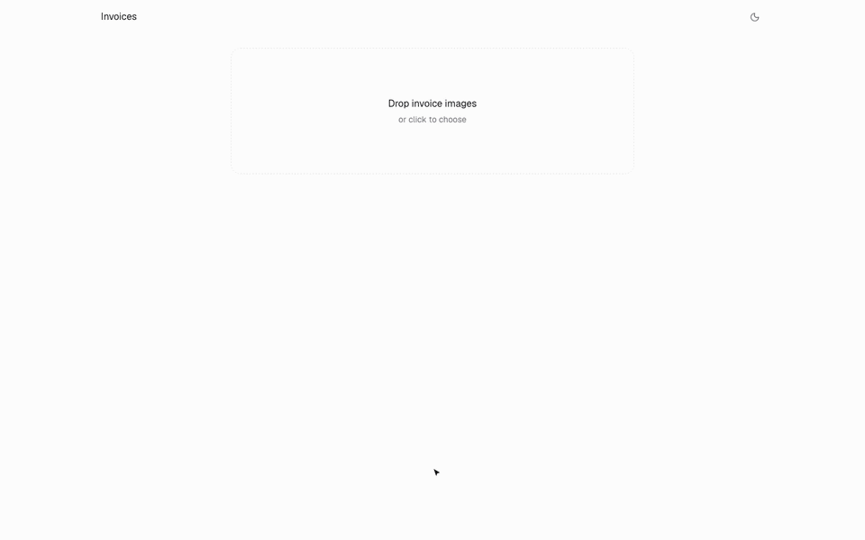

# Invoices

Live: https://invoice-reader-bice.vercel.app · [MP4 walkthrough](docs/walkthrough.mp4)

Upload an invoice or receipt image. It is read, every value is outlined on the original, and you only
check what looks wrong before approving. Works on any invoice or receipt.

## How it works

1. **Read** (`/api/read`): PaddleOCR (via RapidOCR, running locally in `ocr-server/`) finds every piece of text and where it sits. The hosted site uses OCR.space instead (`OCR_PROVIDER=ocrspace`, `OCR_SPACE_API_KEY`).
2. **Understand** (`/api/understand`): a model gets the image and the numbered OCR text and returns vendor, number, date, items, subtotal, tax and total, each pointing at the OCR pieces it came from. Fields stream in as the model writes them. Free models are tried in order, in JSON mode, 45 s each: Gemini 2.5 Flash, GPT-OSS 120B (Groq), Nemotron 3.5 Super VL (OpenRouter). See `lib/understand-models.ts`.
3. **Review**: checks for line maths, totals, missing values and text the OCR was unsure about. Click any value to correct it.

Accuracy on 12 real documents: 96% of fields (see `testset/README.md`, rerun with `node testset/eval.mjs`).

## Run

    cp .env.example .env.local   # add at least one free key
    npm install
    npm run ocr                  # local OCR server on :8765 (needs uv)
    npm run dev                  # http://localhost:3000

Invoices are kept in the browser (localStorage) for now.

## Code

- `app/page.tsx`, `app/invoice/[id]`: upload + list, review screen (`components/invoices/`)
- `lib/invoices/`: types, checks (`analyze.ts`), browser store
- `lib/ocr.ts`, `lib/understand-models.ts`, `app/api/*`: the pipeline
- `components/ui/`: from [Nexvyn UI](https://github.com/Nexvyn/Nexvyn-ui) (MIT + Commons Clause; keep their license notices)
